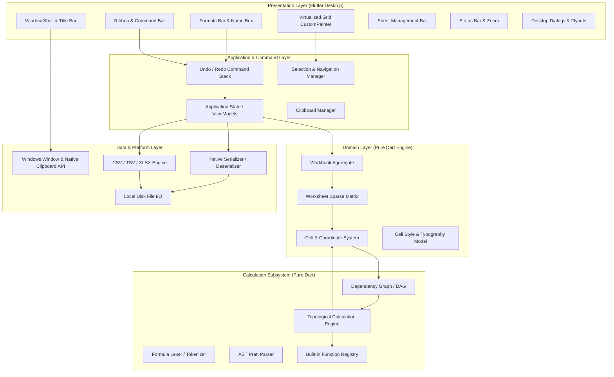

# Grid Sheet — System Architecture & Technical Design

## 1. Architectural Principles & Overview

Grid Sheet is built as a modular, high-density desktop spreadsheet application using Flutter for Windows. To achieve sub-millisecond calculation speeds, smooth 60 FPS viewport scrolling over 1,000,000 cells, and rock-solid undo/redo fidelity, the architecture enforces strict separation of concerns across five primary layers:



> [!IMPORTANT]
> **Implementation Status Note**:
> This document specifies the target architecture for Grid Sheet development. The repository currently contains the baseline Flutter desktop Windows project configuration, directory structure, CI/CD pipelines, and reference assets. The domain engine, virtualized grid, and calculation modules documented below will be implemented sequentially according to [IMPLEMENTATION_PLAN.md](file:///d:/poc/infologia_Tech/GridSheet/docs/IMPLEMENTATION_PLAN.md).

---

## 2. Layer Boundaries & Responsibilities

### 2.1. Presentation Layer (`lib/features/`, `lib/app/`)
- **Technology**: Flutter Desktop Widgets and hardware-accelerated `CustomPainter`.
- **Responsibilities**:
  - Render high-density visual chrome (Title bar, Ribbon tabs, Formula bar, Status bar).
  - Virtualize the spreadsheet grid viewport: compute visible cell boundaries based on scroll offsets, viewport dimensions, and row/column size maps.
  - Draw cell backgrounds, text (using `JetBrains Mono` and `Inter`), borders, and selection highlight bounding boxes directly onto canvas.
  - Translate user pointer (clicks, drags, double-clicks) and keyboard events into abstract navigation or editing intents.
  - **Constraint**: Presentation widgets must never execute formula calculations directly or mutate domain models; all mutations must route through commands.

### 2.2. Application & Command Layer (`lib/core/commands/`, `lib/core/keyboard/`)
- **Pattern**: Command Pattern with bidirectional undo (`execute()` / `undo()`).
- **Responsibilities**:
  - Coordinate application state, active workbook instance, active sheet index, and selection ranges.
  - Encapsulate every user modification (typing a value, pasting cells, changing font size, inserting rows/columns, sorting) into discrete `Command` objects.
  - Maintain the Undo/Redo stack with configurable depth limit.
  - Manage system clipboard interactions (converting cell ranges to tab-separated values `TSV` for cross-app paste, and storing rich serialized cell objects for internal paste).

### 2.3. Domain Layer (`lib/domain/`)
- **Design**: Pure Dart, zero Flutter framework dependencies (allowing 100% headless unit testing and CLI validation).
- **Core Entities**:
  - `CellCoordinate`: Immutable row (`int`) and column (`int`) pair with helper methods for alphanumeric conversions (`(0, 0) <-> A1`, `(10, 3) <-> D11`).
  - `CellRange`: Bounding rectangle defined by top-left and bottom-right `CellCoordinate`s.
  - `Cell`: Contains raw input text, parsed expression/formula AST (if starts with `=`), computed evaluation result (`CellValue`), cell data type (Number, Text, Boolean, Error, Date), and `CellStyle`.
  - `Worksheet`: Sparse 2D matrix storing non-empty cells using a `Map<int, Map<int, Cell>>` or compressed coordinate hash map. Maintains custom column width and row height maps.
  - `Workbook`: Aggregate root managing ordered list of `Worksheet`s, sheet metadata (names, IDs, visibility), and workbook-level named ranges.

### 2.4. Calculation Subsystem (`lib/domain/formula/`)
- **Design**: Isolated pure Dart compiler and evaluation pipeline.
- **Components**:
  1. **Lexer**: Tokenizes raw string input into tokens (`NUMBER`, `STRING`, `IDENTIFIER`, `OPERATOR`, `CELL_REF`, `RANGE_REF`, `COMMA`, `LPAREN`, `RPAREN`).
  2. **Parser**: Pratt / recursive-descent parser producing an Abstract Syntax Tree (`FormulaNode`). Validates syntax, balanced parentheses, and argument separators.
  3. **Dependency Graph (DAG)**: Tracks edges between cells (`A1 -> B1`). Detects directed cycles (circular dependencies) using Tarjan's or Kosaraju's algorithms or depth-first search (DFS) with node coloring (White/Gray/Black).
  4. **Topological Sorter & Evaluator**: Determines the exact recalculation order for dirty cells when an upstream cell value changes, preventing redundant computations.
  5. **Function Registry**: Extensible lookup table mapping function names (`SUM`, `IF`, `VLOOKUP`, `SUMIFS`) to deterministic Dart implementations.

### 2.5. Data & Platform Layer (`lib/data/`, `lib/core/utilities/`)
- **Responsibilities**:
  - **Native Persistence (`lib/data/persistence/`)**: Serialize `Workbook` to and from `.gsheet` JSON/binary structure with schema versioning.
  - **Import / Export (`lib/data/import_export/`)**:
    - RFC 4180 compliant CSV / TSV streaming parser and emitter.
    - XLSX reader and writer mapping OpenXML parts to `Workbook` domain models.
  - **Platform Integration**: Window size and title management, native file pickers (`file_picker`), and Windows clipboard access.

---

## 3. Key Data Flows

### 3.1. Cell Edit and Incremental Recalculation Flow

```text
User Input in Grid / Formula Bar
  │
  ▼
Create 'SetCellCommand(coord, rawText)'
  │
  ▼
CommandStack.execute()
  │
  ├─► Update Cell in Worksheet sparse matrix
  │
  ├─► If starts with '=':
  │     ├─► Lexer.tokenize()
  │     ├─► Parser.parse() -> AST
  │     └─► Extract cell references -> Update Dependency Graph (DAG)
  │
  ├─► Check for circular references (DAG cycle check)
  │     ├─► Cycle found: Mark cells with CellError.circular, notify UI
  │     └─► No cycle: Mark downstream cells as dirty
  │
  ├─► Evaluator.recalculateDirtyCells(topologicalOrder)
  │     └─► For each cell: evaluate AST against referenced cell values -> update Cell.computedValue
  │
  └─► Notify UI Viewport -> CustomPainter repaints dirty cell rectangles
```

### 3.2. Undo / Redo Execution Flow

```text
User presses Ctrl+Z
  │
  ▼
CommandStack.undo()
  │
  ▼
Pop top command from undo stack
  │
  ▼
Command.undo()
  │
  ├─► Revert cell states / styles to previous snapshots
  ├─► Rebuild affected dependency graph edges
  ├─► Re-evaluate dependent cells
  │
  ▼
Push command onto redo stack
  │
  ▼
Trigger Viewport Repaint & Status Bar update
```

---

## 4. Architectural Decisions & Trade-Offs

| Decision | Selected Approach | Rationale | Alternatives Considered |
| :--- | :--- | :--- | :--- |
| **Grid Rendering** | Flutter `CustomPainter` on single canvas | Maximum rendering performance; eliminates overhead of thousands of Flutter `Widget` elements in the tree. Easily achieves 60+ FPS on Windows. | Nested `Table` / `GridView` widgets (causes severe memory bloat and frame drops beyond ~500 visible cells). |
| **Grid Storage** | Sparse Map of Maps (`Map<int, Map<int, Cell>>`) | Memory efficiency. A 1,000,000 x 16,384 grid with 500 populated cells consumes minimal RAM (only active cells allocated). | 2D contiguous array (would consume gigabytes of RAM immediately for empty spreadsheets). |
| **Formula Engine** | Custom pure Dart Pratt parser & DAG | Full deterministic control over operator precedence, exact error propagation (`#DIV/0!`, `#REF!`), zero native C/C++ dependency risks, and 100% testable on any platform. | Third-party JS/C++ spreadsheet engines via FFI (introduces binary packaging complexity and memory synchronization overhead). |
| **State Management** | ChangeNotifier / Riverpod with Command Pattern | Clean, predictable data flow with explicit command reversibility; decouples UI from calculation engine. | Ad-hoc widget state (leads to tight coupling, race conditions, and unmaintainable undo/redo logic). |
| **File Architecture** | Native JSON `.gsheet` + OpenXML `.xlsx` export/import | Native format provides instantaneous local saving and loading with zero translation loss, while XLSX support provides interoperability with Microsoft Excel and Google Sheets. | SQLite database as primary workbook format (overly complex for simple document file exchange). |
