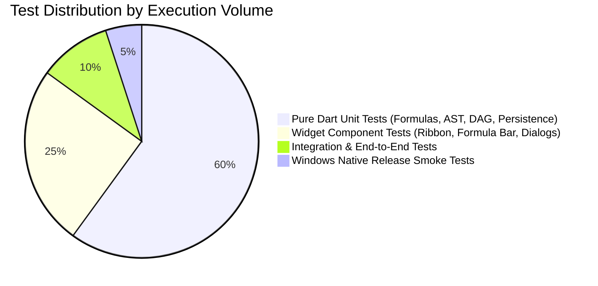

# Grid Sheet — Comprehensive Test Strategy

## 1. Quality Philosophy & Testing Pyramid

Grid Sheet requires high reliability: users trust spreadsheets with financial modeling, data calculations, and business analytics. A calculation bug or serialization corruption is considered a critical defect.

The testing architecture is organized into four complementary layers:

---

## 2. Test Classification & Execution

### 2.1. Pure Dart Unit Tests (`test/unit/`)
- **Scope**: Headless tests with zero dependency on the Flutter UI engine.
- **Coverage Targets**:
  - **Coordinates & Geometry**: Alphanumeric conversion (`A1` <-> `(0, 0)`), range expansion, containment tests, relative coordinate offsetting with `$` anchors.
  - **Formula Lexer & Pratt Parser**: Tokenization correctness, operator precedence (`*` before `+`), nested parenthesized expressions, string literal escaping.
  - **Dependency Graph (DAG) & Cycle Detection**: Adding dependencies, topological sort order, immediate circular reference detection (`A1 -> B1 -> A1`).
  - **Function Evaluation Library**:
    - Math functions (`SUM`, `AVERAGE`, `MIN`, `MAX`, `ROUND`, `MOD`).
    - Logical functions (`IF`, `AND`, `OR`, `NOT`, `IFERROR`).
    - Lookup functions (`VLOOKUP`, `XLOOKUP`, `INDEX`, `MATCH`).
    - Aggregate & text functions (`COUNT`, `COUNTA`, `SUMIF`, `CONCATENATE`).
    - Error conditions (`#DIV/0!`, `#VALUE!`, `#REF!`, `#NAME?`).
  - **Command History**: Reversible execution of all commands (`execute()`, `undo()`, `redo()`).
- **Execution Command**: `flutter test test/unit/`
- **Execution Speed Target**: < 5 seconds for complete unit test suite.

### 2.2. Widget Component Tests (`test/widget/`)
- **Scope**: Flutter widget tests verifying layout, state reflection, event dispatch, and UI rendering.
- **Coverage Targets**:
  - **Formula Bar**: Verification of Name Box display, text input synchronization, expand/collapse toggles, `fx` wizard trigger.
  - **Ribbon & Toolbars**: Button cluster tap handlers, active toggle states (Bold, Italic), dropdown menus.
  - **Worksheet Tab Bar**: Tab item selection, adding new tabs via `+`, context menu triggers (Rename, Delete).
  - **Status Bar**: Live aggregate statistics update when selection changes, zoom slider dispatch.
  - **Modal Dialogs**: Format Cells, Custom Sort, Column Filter, Find & Replace dialog forms and validation.
- **Execution Command**: `flutter test test/widget/`

### 2.3. Persistence & Round-Trip Tests (`test/unit/persistence/`)
- **Scope**: Serialization and deserialization verification.
- **Coverage Targets**:
  - Serializing a populated `Workbook` to JSON string and reconstructing it:
    - 100% preservation of raw formulas and computed values.
    - 100% preservation of custom column widths and row heights.
    - 100% preservation of cell background colors, borders, font weights, and number formats.
    - Multi-sheet tab ordering and active sheet index preservation.
- **Test Fixtures**: Golden JSON files in `test/fixtures/persistence/`.

### 2.4. Import / Export Tests (`test/unit/import_export/`)
- **Scope**: Parsing and formatting accuracy for tabular file formats.
- **Coverage Targets**:
  - **CSV RFC 4180 Parsing**:
    - Embedded commas within quotes (`"Doe, John"`).
    - Embedded newlines within quotes (`"Line 1\nLine 2"`).
    - Escaped quotes (`"Value with ""quotes"""`).
    - Delimiter detection (Comma, Semicolon, Tab).
  - **XLSX OpenXML Ingestion & Emission**: Reading standard Excel workbooks, extracting shared strings, parsing sheet cell data, and writing back compatible `.xlsx` archives.
- **Test Fixtures**: Real-world sample files in `test/fixtures/csv/` and `test/fixtures/xlsx/`.

### 2.5. Desktop Integration Tests (`integration_test/`)
- **Scope**: End-to-end user workflows executing against the compiled Flutter engine.
- **Key Scenarios**:
  1. **New Workbook Workflow**: Launch -> Create Blank Workbook -> Enter values in `A1:A5` -> Enter `=SUM(A1:A5)` in `A6` -> Verify result.
  2. **Formatting & Undo Workflow**: Select range -> Apply Bold & Fill -> Undo (`Ctrl+Z`) -> Verify style reset -> Redo (`Ctrl+Y`) -> Verify style restored.
  3. **Multi-Sheet Formula Workflow**: Add "Sheet2" -> Enter value in `Sheet2!B1` -> Reference in `Sheet1!A1` (`=Sheet2!B1 * 2`) -> Verify dynamic recalculation.
  4. **Save & Reopen Workflow**: Save workbook to temp directory -> Close -> Reopen -> Verify cell values and formulas match original.
- **Execution Command**: `flutter test integration_test/`

### 2.6. Windows Release Smoke Tests (Automated & Manual QA)
- **Scope**: Native executable verification built via `flutter build windows --release`.
- **Smoke Checklist**:
  - Native Windows executable launches without DLL errors or missing C++ runtime prompts.
  - Custom Windows title bar correctly displays minimize, maximize, and close buttons.
  - Keyboard shortcuts (`Ctrl+S`, `Ctrl+Z`, `Ctrl+C`, `Ctrl+V`, arrows) respond instantly.
  - High-DPI scaling (100%, 125%, 150%, 200%) renders without blurry fonts or clipped canvas lines.
  - Multi-window resizing maintains smooth viewport repainting without flickering.

---

## 3. Continuous Integration Gates

In the GitHub Actions CI pipeline (`.github/workflows/ci.yml`), PRs and pushes to `main` must pass the following gates:
1. `dart format --output=none --set-exit-if-changed .` (Zero format violations).
2. `flutter analyze --no-fatal-infos` (Zero errors and zero warnings).
3. `flutter test --coverage` (All unit and widget tests pass).
4. `flutter build windows --release` (Native Windows compilation succeeds).
